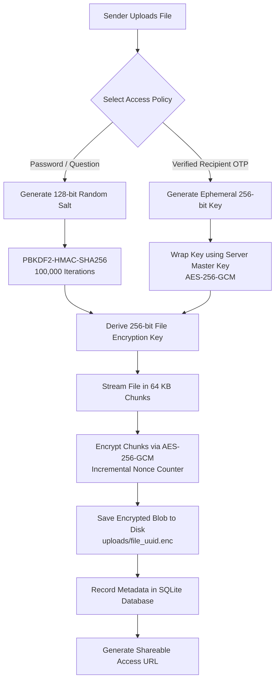
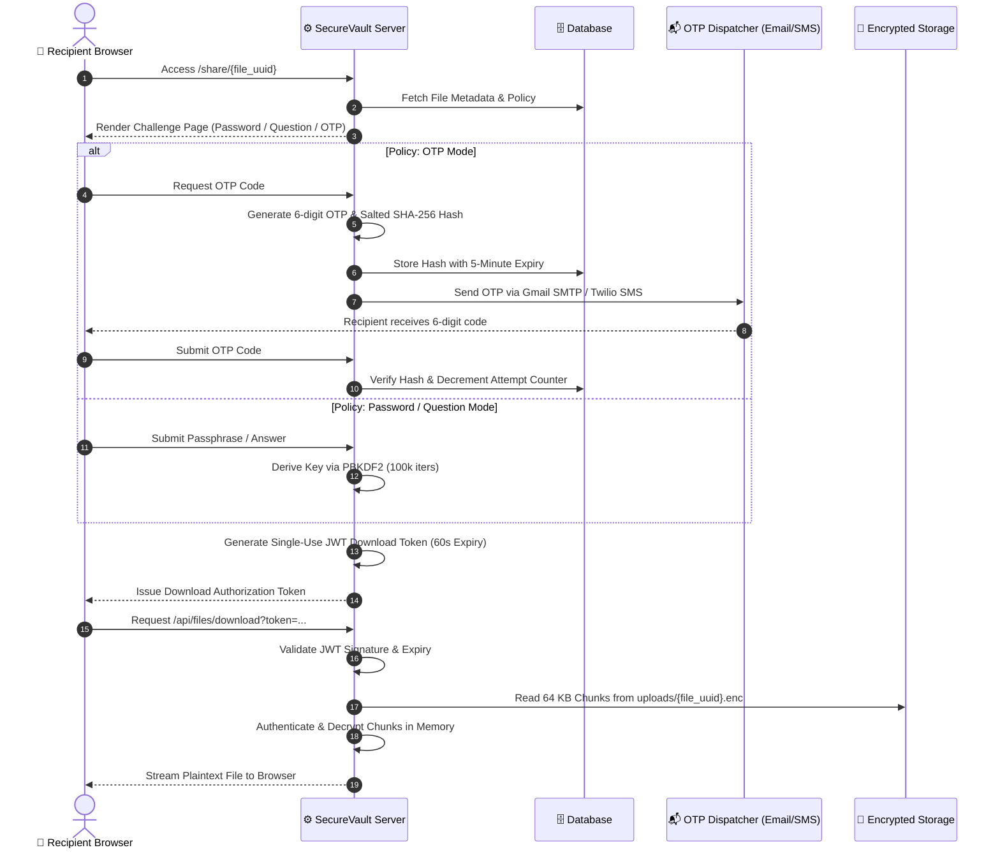

<div align="center">

# 🔐 SecureVault
### Multi-Tier Hybrid Cryptographic File Storage & Sharing Platform

[](https://www.python.org/)
[](https://fastapi.tiangolo.com/)
[](https://cryptography.io/)
[](https://file-encryption-project-hp52.onrender.com/)
[](LICENSE)

<p align="center">
  <b>A zero-trust, enterprise-grade encrypted file transmission portal featuring Authenticated 64 KB Chunk Streaming, PBKDF2 Key Derivation, Dynamic Security Challenges, and Multi-Channel OTP Dispatch (Email & SMS).</b>
</p>

[Key Features](#-key-features) •
[Why SecureVault](#-why-securevault) •
[Security Tiers](#-multi-tier-access-policy-engine) •
[Architecture & Flows](#-system-architecture--workflows) •
[Quickstart](#-quickstart-guide) •
[Project Structure](#-project-directory-structure) •
[API Reference](#-api-endpoints-reference) •
[Contributors](#-authors--contributors)

---

</div>

## 💡 What is SecureVault?

In an era of frequent cloud data breaches and unauthorized surveillance, standard cloud storage solutions store files either unencrypted at rest or with keys controlled entirely by the cloud provider. 

**SecureVault** is an open-source, multi-tier hybrid cryptographic vault engineered to give users absolute control over who can decrypt and access their sensitive files. Files uploaded to SecureVault are encrypted using **AES-256-GCM authenticated streaming**, ensuring both absolute confidentiality and tamper-proof ciphertext verification. 

Senders can set dynamic decryption gates ranging from simple passphrases to cryptographic secret questions and time-limited, multi-channel **One-Time Passwords (OTPs)** sent directly to the recipient's verified Email or Phone Number.

---

## 📊 Comparison Matrix

| Security Feature | Standard Cloud Sharing (Google Drive, Dropbox) | Traditional Password-Zip | 🔐 SecureVault |
| :--- | :---: | :---: | :---: |
| **End-to-End AEAD Encryption** | ❌ (Provider Holds Keys) | ⚠️ (Vulnerable ZipCrypto / Legacy AES) | ✅ **AES-256-GCM with 128-bit Auth Tags** |
| **Tamper & Corruption Detection** | ❌ | ❌ | ✅ **Instant Bit-Flip Invalidation** |
| **Large File Memory Streaming** | ⚠️ (Buffers to Disk/RAM) | ❌ (Full Extraction in Memory) | ✅ **64 KB Chunked Low-RAM Streaming** |
| **Multi-Channel Recipient OTP** | ❌ | ❌ | ✅ **Gmail SMTP TLS & SMS (Twilio/Fast2SMS)** |
| **Zero-Knowledge Decryption** | ❌ | ⚠️ | ✅ **Server Never Knows Master Passphrase** |
| **Ephemeral Single-Use Download Tokens** | ❌ (Static Share Links) | ❌ | ✅ **Cryptographically Signed JWTs (60s Expiry)** |
| **Anti-Brute Force Protections** | ⚠️ | ❌ | ✅ **Salted SHA-256 + 5-Attempt Rate Limiting** |

---

## 🌟 Key Features

- **🔒 Authenticated AEAD Encryption (AES-256-GCM)**: Every chunk is encrypted with an authenticated 128-bit authentication tag, making silent ciphertext tampering or byte corruption impossible.
- **⚡ Memory-Efficient 64 KB Chunked Streaming**: Files of any size (from small PDFs to multi-gigabyte ISOs) are encrypted and decrypted in 64 KB streaming buffers, preventing server memory exhaustion (DoS).
- **🛡️ 3-Tier Granular Access Policies**: Tailor access restrictions per recipient clearance: Passphrase, Challenge Question, or Identity-Verified OTP.
- **🔑 Server Master Key Enveloping**: In OTP mode, ephemeral 256-bit file keys are securely wrapped using an AES-256-GCM server master key before storage; plain keys are never committed to the database.
- **📲 Multi-Channel OTP Dispatcher**: Pluggable backend supporting **Console Mode** (development/offline testing), **Gmail SMTP with TLS**, **Twilio SMS**, and **Fast2SMS**.
- **🎫 Ephemeral JWT Download Tokens**: Challenge validation produces short-lived, single-use JWT authorization tickets, preventing replay attacks or unauthorized link forwarding.
- **🎨 Modern Cyberpunk Glassmorphism UI**: High-contrast, responsive dark-mode dashboard styled with dynamic CSS glow spheres, cyber-grid animations, and Google Fonts (`Space Grotesk` & `Outfit`).

---

## 🛡️ Multi-Tier Access Policy Engine

SecureVault provides three distinct clearance modes for securing files:

### 1️⃣ Tier 1: Passphrase Challenge (`PASSWORD`)
- **Use Case:** Direct point-to-point file exchange with an agreed-upon shared secret.
- **Mechanism:** A unique 128-bit cryptographic salt is generated per file. A 256-bit AES key is derived via **PBKDF2-HMAC-SHA256** using 100,000 iterations.
- **Security:** Zero-knowledge architecture—the server never stores or logs the passphrase. Without the secret, recovery is computationally infeasible.

### 2️⃣ Tier 2: Cryptographic Security Question (`QUESTION`)
- **Use Case:** Asymmetric knowledge exchange between trusted associates without access to external communication channels.
- **Mechanism:** The sender poses a custom challenge question. The recipient's answer is normalized (trimmed and case-standardized) and used as the PBKDF2 seed key.

### 3️⃣ Tier 3: Automated Multi-Channel OTP (`OTP`)
- **Use Case:** High-security enterprise document dispatch with identity verification.
- **Mechanism:** The sender generates a random ephemeral 256-bit AES key for the file, which is then wrapped and sealed with the server's master key.
- **Workflow:** Senders specify the recipient's email or phone number. When the recipient accesses the link, they request a secure 6-digit OTP code delivered via Email or SMS. Once validated against a salted SHA-256 hash, the server unwraps the file key and streams the decrypted payload.

---

## 🔄 System Architecture & Workflows

### 📤 1. File Upload & Encryption Pipeline



---

### 📥 2. Recipient Verification & Streaming Decryption Pipeline



---

## 🚀 Quickstart Guide

### 📋 Prerequisites
- **Python 3.10+** ([Download Python](https://www.python.org/downloads/))
- **Git** ([Download Git](https://git-scm.com/))

---

### ⚡ Option 1: 1-Click Launch (Windows)

Simply double-click [`start_app.bat`](file:///start_app.bat) or run in PowerShell:
```powershell
.\start_app.bat
```
*This automatically checks for your virtual environment, copies `.env.example` if needed, and starts the FastAPI server.*

---

### 🛠️ Option 2: Manual Setup (Cross-Platform)

#### 1. Clone the Repository
```bash
git clone https://github.com/pillisaimedhas-dev/file_encryption_project.git
cd file_encryption_project
```

#### 2. Create and Activate a Virtual Environment
```bash
# Windows (PowerShell / CMD)
python -m venv venv
venv\Scripts\activate

# macOS / Linux
python3 -m venv venv
source venv/bin/activate
```

#### 3. Install Dependencies
```bash
pip install -r requirements.txt
```

#### 4. Configure Environment Variables
Copy the template configuration file:
```bash
# Windows
copy .env.example .env

# macOS / Linux
cp .env.example .env
```

Open `.env` to configure your keys. You can generate secure 256-bit keys using Python:
```bash
python -c "import secrets; print('KEY: ' + secrets.token_hex(32))"
```

Sample `.env` settings:
```ini
PORT=8000
HOST=127.0.0.1
DATABASE_URL=sqlite:///./secure_vault.db

# 256-bit Hex Keys
JWT_SECRET_KEY=4a87f1c3d902b85e612f04e1bc2a39d84e5f60718293a4b5c6d7e8f901234567
SERVER_MASTER_KEY=9b20e14a87f1c3d902b85e612f04e1bc2a39d84e5f60718293a4b5c6d7e8f901

# OTP Dispatch Mode: 'console' (default for testing), 'email', 'twilio', or 'fast2sms'
OTP_PROVIDER=console

# Optional: Email Dispatcher via Gmail SMTP TLS
SMTP_SERVER=smtp.gmail.com
SMTP_PORT=587
SENDER_EMAIL=your_email@gmail.com
SENDER_PASSWORD=your_16_character_app_password
```

#### 5. Run the Application
```bash
python run.py
```
*Or directly via Uvicorn:*
```bash
uvicorn app.main:app --host 127.0.0.1 --port 8000 --reload
```

---

## 🌐 Application Portals & Endpoints

| Portal | Local URL | 🌐 Live Cloud URL | Description |
| :--- | :--- | :--- | :--- |
| **Vault Home & Login** | [http://localhost:8000](http://localhost:8000) | [file-encryption-project...onrender.com](https://file-encryption-project-hp52.onrender.com/) | User authentication & node access |
| **Secure Dashboard** | [http://localhost:8000/dashboard](http://localhost:8000/dashboard) | [/dashboard](https://file-encryption-project-hp52.onrender.com/dashboard) | File upload manager, policies & share links |
| **Interactive Swagger Docs** | [http://localhost:8000/docs](http://localhost:8000/docs) | [/docs](https://file-encryption-project-hp52.onrender.com/docs) | Live API testing & schema documentation |
| **Health Monitor** | [http://localhost:8000/health](http://localhost:8000/health) | [/health](https://file-encryption-project-hp52.onrender.com/health) | 24/7 Cloud health & uptime endpoint |

---

## 🧪 Automated Testing Suite

SecureVault includes automated unit tests and integration tests covering the entire cryptographic engine and API endpoints.

### 1. Cryptographic Engine Unit Tests
Tests key derivation, master key wrapping, 64 KB AEAD streaming, and OTP hashing:
```bash
python tests/test_crypto.py
```

### 2. End-to-End Integration Tests
Validates the full pipeline: user registration, login, multi-tier uploads (Password, Security Question, OTP), challenge verification, and streaming downloads:
*(Ensure the server is running on `http://127.0.0.1:8000`)*
```bash
python tests/test_integration.py
```

---

## 📂 Project Directory Structure

```
file_encryption_project/
├── app/
│   ├── __init__.py                # Package initialization & exports
│   ├── main.py                    # FastAPI server, endpoints, and route controllers
│   ├── database.py                # SQLAlchemy engine & session factory
│   ├── models.py                  # Database tables: User, EncryptedFile, ActiveOTP
│   ├── crypto_utils.py            # AES-256-GCM 64 KB streaming engine & PBKDF2
│   ├── otp_service.py             # OTP dispatcher (Console, Gmail SMTP, SMS)
│   ├── static/                    # Frontend client assets
│   │   ├── css/
│   │   │   └── style.css          # Glassmorphic cyberpunk styling & theme
│   │   └── js/
│   │       └── app.js             # Client async upload & challenge validation logic
│   └── templates/                 # Jinja2 HTML5 dynamic templates
│       ├── index.html             # Access authentication & node registration
│       ├── dashboard.html         # User vault dashboard & file management
│       └── decrypt.html           # Public recipient decryption & challenge portal
├── data/                          # Sample validation fixtures
│   └── sample.txt                 # Test vector document
├── tests/                         # Comprehensive automated test suite
│   ├── __init__.py
│   ├── test_crypto.py             # Cryptographic algorithms unit tests
│   └── test_integration.py        # End-to-end user & file pipeline tests
├── uploads/                       # Encrypted ciphertext storage directory (.enc blobs)
│   └── .gitkeep                   # Preserves folder in git without uploading blobs
├── .env.example                   # Environment configuration template
├── .gitignore                     # Git rules protecting database, secrets & uploads
├── LICENSE                        # MIT Open Source License
├── requirements.txt               # Production Python dependencies
├── run.py                         # Application runner script
├── start_app.bat                  # 1-click Windows startup batch script
└── README.md                      # Comprehensive repository documentation
```

---

## 📡 API Endpoints Reference

### 🔐 Authentication (`/api/auth`)
| Method | Endpoint | Parameters | Description |
| :---: | :--- | :--- | :--- |
| `POST` | `/api/auth/register` | `username`, `email`, `password` | Register new user vault account |
| `POST` | `/api/auth/login` | `username`, `password` | Authenticate and obtain session cookie |
| `GET` | `/api/auth/logout` | — | Invalidate session and redirect to login |

### 📁 File Management & Cryptography (`/api/files`)
| Method | Endpoint | Parameters | Description |
| :---: | :--- | :--- | :--- |
| `POST` | `/api/files/upload` | `file`, `policy`, `secret`, `recipient` | Encrypt in 64 KB chunks and store |
| `GET` | `/api/files/my-files` | — | List all files encrypted by user |
| `DELETE`| `/api/files/{file_id}`| `file_id` | Permanently delete file and ciphertext |

### 🔓 Recipient Decryption & Verification
| Method | Endpoint | Parameters | Description |
| :---: | :--- | :--- | :--- |
| `GET` | `/share/{file_id}` | `file_id` | Public recipient access & challenge portal |
| `POST` | `/api/challenge/request-otp` | `file_id` | Generate and dispatch time-limited OTP |
| `POST` | `/api/challenge/verify-otp` | `file_id`, `otp` | Verify OTP code and obtain download token |
| `POST` | `/api/challenge/verify` | `file_id`, `answer` | Verify Password/Question and obtain token |
| `GET` | `/api/files/download` | `token` (Query param) | Stream authenticated decrypted payload |

---

## 🛡️ Security Best Practices & Design Principles

1. **Zero Knowledge on Passphrase Tiers**: Passphrases and challenge answers are never written to disk, databases, or logs.
2. **Authenticated AEAD Ciphertext**: AES-256-GCM uses 128-bit integrity tags. Any modification or bit-level corruption is caught instantly before data reaches the user.
3. **Chunked Streaming (DoS Resilience)**: Encrypting and decrypting in 64 KB buffers ensures memory usage remains constant (~a few megabytes) regardless of file size.
4. **Master Key Separation**: File encryption keys are enveloped with an independent 256-bit server master key stored exclusively in server environment variables.
5. **Anti-Brute Force Protections**: OTP codes expire within 5 minutes and are locked after 5 failed verification attempts.
6. **No-Cache Browser Policies**: Sensitive views send strict `Cache-Control: no-cache, no-store, must-revalidate` headers to prevent private tokens or file names from persisting in shared browser histories.

---

## 👥 Authors & Contributors

<div align="center">

| Contributor | Role & GitHub |
| :--- | :--- |
| **Pilli Sai Medhas** | Lead Developer & Cryptographic Engine Architect<br/>[](https://github.com/pillisaimedhas-dev) |
| **Jammula Rithik Reddy** | Co-Developer & Full-Stack Security Engineer<br/>[](https://github.com/crazynani1432) |
| **Achukatulu Kaif** | Co-Developer & System Architecture Contributor<br/>[](https://github.com/kaifachukatlu) |

</div>

---

## 📜 License

This project is licensed under the **MIT License** — see the [LICENSE](LICENSE) file for complete details.
